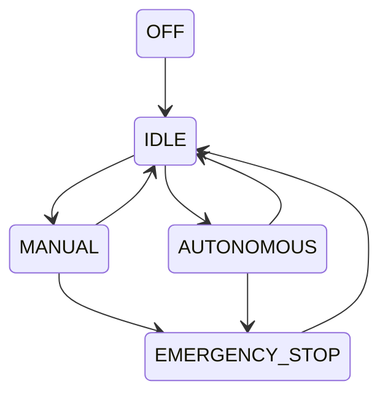

# Atlas State Machine

## Purpose

The state machine controls the operational mode of Atlas and ensures
only valid transitions occur.

## States

- OFF
- IDLE
- MANUAL
- AUTONOMOUS
- FAULT
- EMERGENCY_STOP

