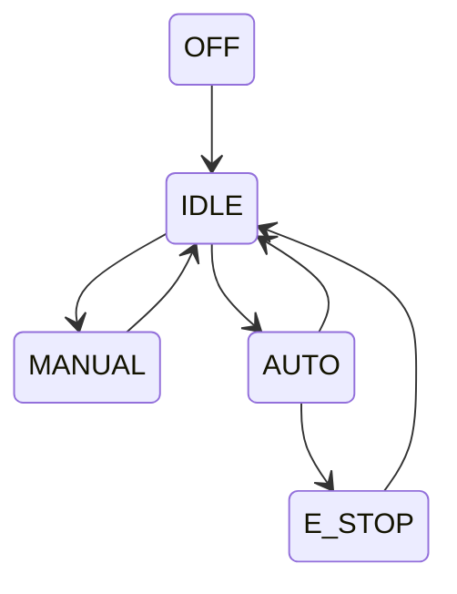

# Atlas State Machine

## Purpose

The state machine controls the operational mode of Atlas and ensures
only valid transitions occur. State machine will change state after validation

## States

- OFF - 0
- IDLE - 1
- MANUAL - 2
- AUTO - 3
- E_STOP - 9

## Allowed Transitions
OFF -> IDLE
IDLE -> MANUAL
IDLE -> AUTO
MANUAL -> IDLE
AUTO -> IDLE
AUTO -> E_STOP
E_STOP -> IDLE

## Conditional Transition
# IDLE -> AUTO
    Condition:
    1) diagnostics healthy
    2) mission loaded

# AUTO -> E_STOP
    Condition:
    Safety system reports fault