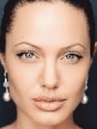
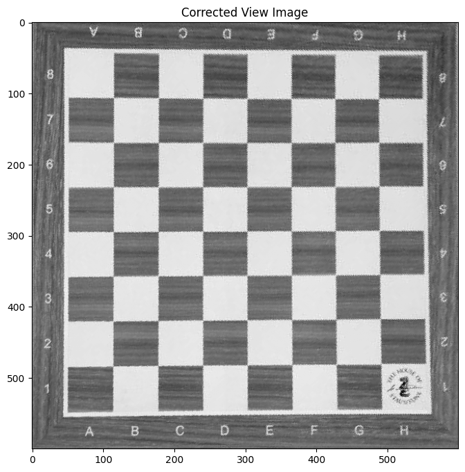
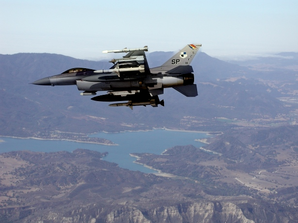

# Computer Vision

> Geometry, image formation, warping, and gradient-domain optimization.

| Project | Mathematical focus | Recorded deliverables |
|---|---|---|
| [Homography](homography/README.md) | Projective transformations; homogeneous coordinates | Correspondence, perspective correction, panorama stitching |
| [Image morphing](image-morphing/README.md) | Delaunay-style triangulation, piecewise affine warp, interpolation | Three passing notebook tests; three GIF artifacts |
| [Poisson image editing](poisson-editing/README.md) | Discrete Poisson equation, sparse reconstruction, gradient selection | Cloned, mixed, flattened images |

## Image morphing · shape and appearance

[Explore all three animations →](image-morphing/README.md)

## Homography · perspective correction

[View correspondences and stitching →](homography/README.md)

## Poisson editing · gradient-domain reconstruction

[Compare cloning, mixed gradients, and texture flattening →](poisson-editing/README.md)

**Presentation scope:** Selected original result figures and animations, mathematical explanations, and recorded observations. No instructor-provided code, assignment notebooks, dataset files, or implementation solutions are included.

[← Portfolio index](../SHOWCASE.md)
