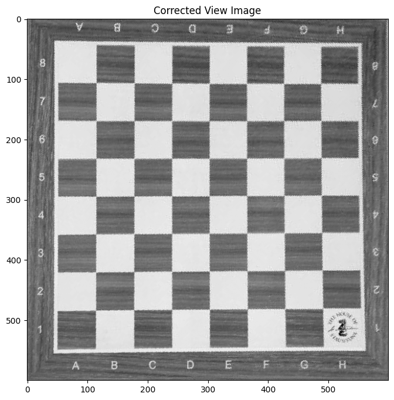
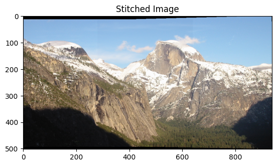

# Homography · Perspective Correction & Stitching

**Projective geometry · Image registration · Fall 2026**

## Objective

Use point correspondences to estimate a planar projective mapping and apply it to perspective correction and image stitching.

## Mathematics

A homography maps points in homogeneous coordinates:

$$\lambda\begin{bmatrix}x'\\y'\\1\end{bmatrix}=H\begin{bmatrix}x\\y\\1\end{bmatrix},\qquad H\in\mathbb R^{3\times3}.$$

Because scale is arbitrary, \(H\) has eight degrees of freedom. At least four nondegenerate point correspondences are needed for a direct estimate. Reprojection error is a natural evaluation quantity:

$$e_i=\left\|\mathbf x'_i-\pi(H\tilde{\mathbf x}_i)\right\|_2.$$

Here \(\pi\) denotes homogeneous normalization. The notebook demonstrates correspondence visualization, image stitching, and perspective correction; **no aggregate reprojection-error measurement is recorded** in the supplied artifacts.

## Verified result artifacts

- **correspondence_image.png** — matched feature-point visualization
- **stitched_view_image.png** — stitched-view result
- **corrected_view_image.png** — perspective-corrected view

### Point correspondences

### Perspective correction

### Image stitching

These are the supplied result images, preserved without modification. Source code, notebooks, and dataset files are excluded.

## Verification notes

The notebook contains saved visual outputs. An earlier cell recorded an interrupted execution, so the full notebook has **not** been certified as a clean end-to-end rerun. No numerical registration accuracy or runtime is claimed.

[← Computer Vision](../README.md) · [Portfolio index](../../SHOWCASE.md)
