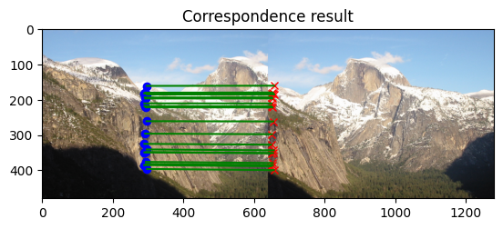

# Homography · Perspective Correction & Stitching

**Projective geometry · Image registration · Fall 2026**

## Objective

Use point correspondences to estimate a planar projective mapping and apply it to perspective correction and image stitching.

## Mathematics

A homography maps points in homogeneous coordinates:

```math
\lambda\begin{bmatrix}x'\\y'\\1\end{bmatrix}=H\begin{bmatrix}x\\y\\1\end{bmatrix},\qquad H\in\mathbb R^{3\times3}.
```

Because scale is arbitrary, $H$ has eight degrees of freedom. At least four nondegenerate point correspondences are needed for a direct estimate. Reprojection error is a natural evaluation quantity:

```math
e_i=\left\|\mathbf x'_i-\pi(H\tilde{\mathbf x}_i)\right\|_2.
```

Here $\pi$ denotes homogeneous normalization. The results below show point correspondences, perspective correction, and image stitching.

## Results

### Point correspondences



### Perspective correction


### Image stitching


## Evaluation

Results are evaluated visually. Aggregate reprojection error and runtime were not measured.

[← Computer Vision](../README.md) · [Portfolio index](../../SHOWCASE.md)
