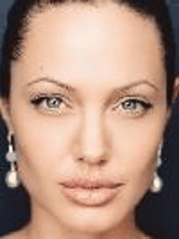
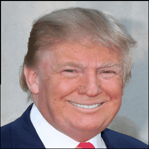
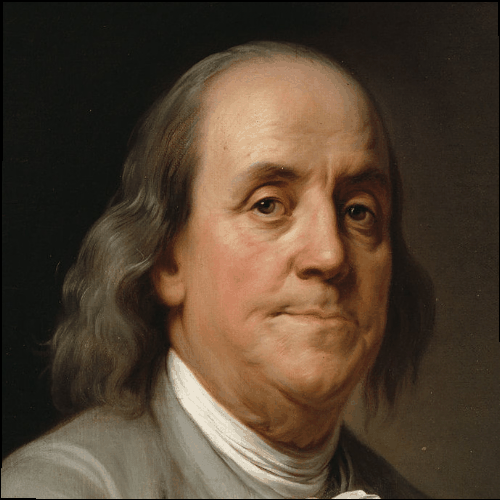

# Image Morphing · Geometry to Animation

**Triangulated warping · Affine transforms · Image interpolation · Fall 2026**

## Objective

Produce a continuous transition between two images by interpolating both the **shape** (landmark geometry) and the **appearance** (pixel colors).

## Mathematics

Given corresponding landmarks $\mathbf p_i^A,\mathbf p_i^B$, the intermediate shape at $t\in[0,1]$ is

```math
\mathbf p_i(t)=(1-t)\mathbf p_i^A+t\mathbf p_i^B.
```

Each corresponding triangle defines a piecewise affine warp. After warping both source images into the intermediate geometry, appearance is interpolated:

```math
I_t(\mathbf x)=(1-t)I_A(W_A^{-1}(\mathbf x,t))+tI_B(W_B^{-1}(\mathbf x,t)).
```

This separates **geometric alignment** from **cross-dissolve**; blending without warping would produce ghosting rather than a shape transition.

## Results

Three animations demonstrate transitions in landmark geometry and appearance. **3/3 project checks passed in the recorded run.** Image quality is evaluated visually; no quantitative image-quality benchmark was measured.

### Face morph



### Custom morph 1



### Custom morph 2



[← Computer Vision](../README.md) · [Portfolio index](../../SHOWCASE.md)
