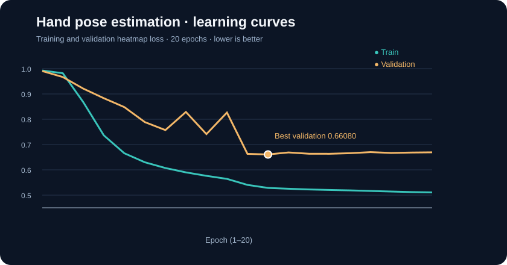

# Machine Learning

> From supervised learning objectives to model behavior and evaluation.

## Featured case study

### [2D hand pose estimation →](hand-pose-estimation/README.md)

A 21-joint heatmap-regression pipeline on an Ego-Exo4D subset, using a shallow encoder–decoder convolutional network. The submitted notebook records **20 training epochs**, a **best validation heatmap loss of 0.66080**, and example joint-level inference errors.

### Ground truth and model prediction

| Ground truth | Prediction |
|---|---|
|  |  |

### Recorded optimization progress

**Evidence boundary:** No test-set aggregate accuracy, PCK, or MPJPE was recorded in the inspected outputs; none is claimed here.

[← Portfolio index](../SHOWCASE.md)
