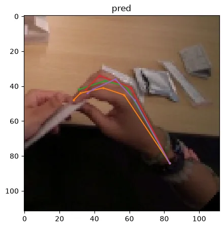

# Machine Learning

> From supervised learning objectives to model behavior and evaluation.

## Featured case study

### [2D hand pose estimation →](hand-pose-estimation/README.md)

A 21-joint heatmap-regression pipeline on an Ego-Exo4D subset, using a shallow encoder–decoder convolutional network. The experiment ran for **20 training epochs**, reaching a **best validation heatmap loss of 0.66080**. The case study includes selected joint-level prediction errors.

### Ground truth and model prediction

| Ground truth | Prediction |
|---|---|
|  |  |

### Training and validation loss

**Evaluation scope:** Validation heatmap loss and selected joint-level errors; aggregate test-set keypoint accuracy has not been measured.

[← Portfolio index](../SHOWCASE.md)
