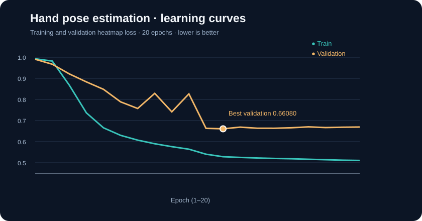
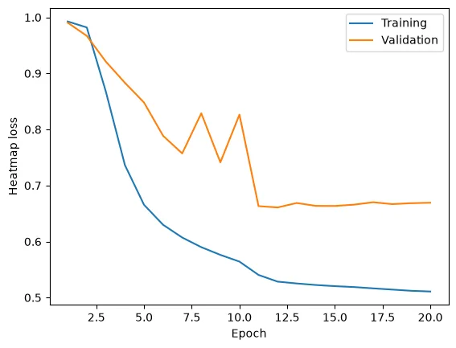
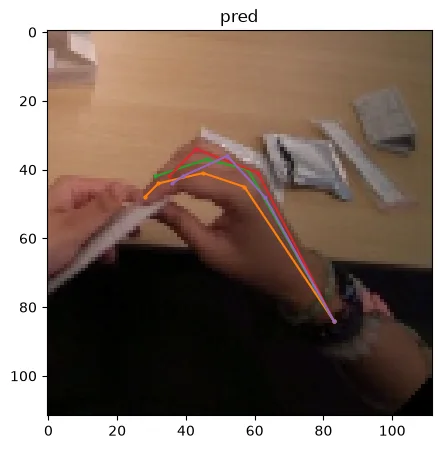

# 2D Hand Pose Estimation

**Computer vision · Deep learning · Heatmap regression · Fall 2026**

## The problem

Given a cropped egocentric hand image, estimate the locations of **21 anatomical keypoints**. The experiment uses a subset of the Ego-Exo4D dataset and a top-down pipeline: hand crops are provided, then a model predicts one heatmap per joint. This is **pose estimation, not a hand-detector benchmark**.

## Mathematical formulation

For input image $I$, the convolutional network $f_\theta$ predicts heatmaps $\hat H=f_\theta(I)\in\mathbb R^{21\times112\times112}$. A joint coordinate is estimated by the heatmap maximum:

```math
\hat{\mathbf p}_j=\underset{(x,y)}{\mathrm{argmax}}\;\hat H_j(x,y).
```

The training objective compares predicted heatmaps with target heatmaps, with visibility-aware supervision as defined in the supplied course pipeline. The numerical loss below is **heatmap loss**, not a distance in pixels.

## Recorded experiment

| Measurement | Recorded value |
|---|---:|
| Training samples | **20,998** |
| Validation samples | **5,911** |
| Test samples | **7,813** |
| Training epochs | **20** |
| Model output tensor (shape test) | **1 × 21 × 112 × 112** |
| Initial validation loss | **0.99048** |
| Best validation loss | **0.66080** (epoch 12, 1-indexed) |
| Final validation loss | **0.66929** |
| Relative reduction from initial to best validation loss | **33.3%** |



The validation curve is not monotonic; the lowest recorded validation loss occurred before the final epoch. A pretrained-weight loading step was also recorded in the notebook; results should **not** be described as training from scratch.

### Example keypoint errors

The notebook printed Euclidean pixel errors for **four visible joints on one selected test example**: **1.4 px, 2.2 px, 3.0 px, and 1.0 px** (joint indices 0, 8, 12, 16). Their arithmetic mean is **1.9 px for these four selected joints only**. This is **not** an aggregate test-set score or a validated model benchmark. Two other queried joints had no printed error in that sample.

## Visual results

### Input and annotated example



### Ground truth and model prediction

| Ground truth | Prediction |
|---|---|
|  |  |

These selected qualitative examples complement the recorded loss curve; they do not establish aggregate test-set accuracy.

## Interpretation and limitations

- The loss improvement documents optimization progress, not a 33.3% increase in pose accuracy.
- Dataset annotations may contain missing or imperfect labels, as noted in the project material.
- The reported sample errors do not establish performance across subjects, activities, or the full test split.
- No independently verified PCK, normalized keypoint error, or end-to-end hand detection score is available from the inspected artifacts.
- Only the selected result figures are shown. Instructor scaffolding, source code, notebooks, model weights, and dataset files are excluded.

## Provenance

Source: uploaded executed notebook **Fall2026_Viru_Vilvanathan_Project7.ipynb** and associated PDF reflection report. All numeric results above were transcribed from saved notebook outputs, not produced by a new training run. Chart is a faithful plot of recorded per-epoch losses.

[← Machine Learning](../README.md) · [Portfolio index](../../SHOWCASE.md)
